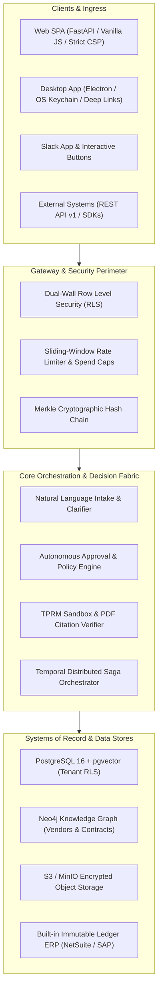

# Omnea Procure OS

An enterprise-grade, AI-native procurement orchestration platform and autonomous operating system for intake, multi-tier approvals, third-party risk management (TPRM), systems of record synchronization, and financial reconciliation.

---

## Architecture Overview

Omnea coordinates five architectural tiers to deliver end-to-end procurement governance:



---

## 5-Minute Quickstart

### Prerequisites
- Python 3.11+
- [uv](https://docs.astral.sh/uv/) package manager
- Docker & Docker Compose
- Node.js v20+ (for Desktop application)

### 1. Clone & Bootstrap Environment
```bash
cp .env.example .env
uv sync --all-packages
```

### 2. Start Backing Infrastructure
Launch PostgreSQL (pgvector), Neo4j, MinIO, and Temporal:
```bash
docker compose -f infra/docker-compose.yml up -d
```

### 3. Run Database Migrations
Apply Alembic migrations to construct all tenant-partitioned schemas:
```bash
uv run alembic -c infra/alembic/alembic.ini upgrade head
```

### 4. Start API & Web Gateway
```bash
uv run uvicorn api.main:app --host 0.0.0.0 --port 8000 --reload
```
Open [http://localhost:8000/app](http://localhost:8000/app) in your browser.

---

## Configuration & Setup Guides

### 1. LLM Provider Configuration
Omnea uses a guarded LiteLLM client enforcing schema validation, pre-flight spend caps, and token limits:
- Set `LLM_MODEL` in `.env` (e.g. `gemini/gemini-1.5-flash`, `gpt-4o-mini`, or `claude-3-5-sonnet-20241022`).
- Set `LLM_API_KEY` with your provider secret.
- **Spend Protection**: Set `LLM_GLOBAL_DAILY_BUDGET_USD=25.00` and `LLM_TENANT_DAILY_BUDGET_USD=5.00` to prevent runaway cloud costs.

### 2. Email Delivery Setup
- Set `EMAIL_PROVIDER` (`resend`, `postmark`, `ses`, or `fake`).
- Provide `RESEND_API_KEY` or AWS SES credentials.
- Set `EMAIL_FROM_ADDRESS` to your verified sending domain (e.g., `noreply@omnea.ai`).

### 3. Slack Integration Setup
1. Create a Slack App at [api.slack.com/apps](https://api.slack.com/apps) from `infra/slack/manifest.json`.
2. Copy `SLACK_SIGNING_SECRET` and `SLACK_BOT_TOKEN` into `.env`.
3. Configure Slack Request URLs:
   - Events API: `https://<your-host>/api/v1/ingress/slack/events`
   - Interactive Buttons: `https://<your-host>/api/v1/slack/interactive`

### 4. OIDC / Single Sign-On (SSO) Setup
- **Google OAuth**: Set `GOOGLE_CLIENT_ID` and `GOOGLE_CLIENT_SECRET`.
- **Microsoft Entra ID**: Set `MICROSOFT_CLIENT_ID` and `MICROSOFT_CLIENT_SECRET`.

### 5. Systems of Record ERP Setup
- **Built-In Ledger ERP**: Works immediately out-of-the-box with zero third-party configuration.
- **NetSuite / SAP / Workday**: Tenant administrators configure credentials in Settings (`/app/settings`). Credentials are encrypted using AES-256-GCM via the Encrypted Secrets Manager and stored only as abstract vault references.

### 6. Render Cloud Deployment Setup
Deploy the full stack to Render with a single click via `render.yaml`:
1. Push your repository to GitHub.
2. In Render, select **New Blueprint Instance** and select your repository.
3. Render automatically provisions the PostgreSQL database, runs migrations as a release step, starts the API, and boots background workers.
4. Set required secret variables (`TEMPORAL_TARGET_HOST`, `LLM_API_KEY`, etc.) in the Render dashboard.

### 7. Desktop Application Setup
```bash
cd desktop
npm install
npm run start
```
The desktop app features OS keychain token storage, `procure://` deep link support, native notification badges, and a read-only offline cache.

---

## Verified vs Not Verified Register

Omnea maintains a transparent verification register:
- **Verified Capabilities**: Dual-Wall RLS, Cryptographic Audit Hash Chain, Strict CSP (Self-Hosted Swagger), Evidence Viewer with verified offset citations, Idempotent Saga with Crash Recovery at 4 named kill points, Scoped API Keys, Outbound HMAC Webhooks, and Public Spend Budget Guards.
- **Simulated Boundaries**: Injected Slack client, Fake LLM client, and Mock ERP connectors for third-party cloud environments lacking production sandbox credentials.

Read the complete register in [docs/CLAIMS_REGISTER.md](docs/CLAIMS_REGISTER.md).

---

## Documentation & Governance Links

- **Claims Register**: [docs/CLAIMS_REGISTER.md](docs/CLAIMS_REGISTER.md)
- **Security Policy**: [SECURITY.md](SECURITY.md)
- **AI Multi-Agent Development**: [docs/ai-development.md](docs/ai-development.md)
- **3-Minute Demo Script**: [docs/demo-script.md](docs/demo-script.md)
- **License**: [LICENSE](LICENSE) (Apache License 2.0)
