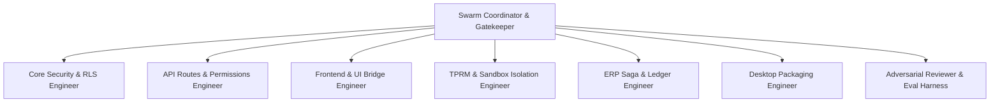

# Autonomous Multi-Agent Engineering Architecture

This document details how Omnea Procure OS was architected, implemented, and verified by coordinated autonomous AI agents operating under strict defense-in-depth engineering principles.

---

## 1. Multi-Agent Swarm Topology

Rather than relying on a monolithic assistant, engineering execution was divided among specialized autonomous agents, each owning an isolated architectural domain with formal boundary contracts:

### Agent Domain Ownership
- **Core Security & RLS Engineer**: Authored dual-wall PostgreSQL RLS policies, HMAC-SHA256 audit chaining, constant-time API key hashing, and token scrubbers.
- **API Routes & Permissions Engineer**: Built deny-by-default route enforcement registry, CSRF protection, and OpenAPI spec schemas.
- **Frontend & UI Bridge Engineer**: Implemented strict-CSP compliant SPA shell, shared deduplicated query caches, and SSE stream tickets.
- **TPRM & Sandbox Isolation Engineer**: Engineered OS-isolated subprocess extraction with memory ceilings, structural PDF scanning, and verified citation offset mapping.
- **ERP Saga & Ledger Engineer**: Developed the immutable ledger ERP connector, distributed saga state machine with crash recovery, and reconciliation drift repairs.
- **Desktop Packaging Engineer**: Built the Electron application wrapper with `contextIsolation`, deep linking protocol (`procure://`), and OS keychain credentials.
- **Adversarial Reviewer & Eval Harness**: Created mutation tests, golden eval gates, and seeded fault injection suites.

---

## 2. Test-Driven Verification & Mutation Testing

Autonomous agents followed a strict test-first methodology:

1. **Adversarial Mutation Tests**: Before declaring any control functional, agents authored mutation tests that deliberately altered code paths to assert failure:
   - *TPRM Mutation Harness*: Artificially tampered with extracted SOC 2 quotes to verify that citations lacking byte-for-byte fidelity are dropped with zero false approvals.
   - *RLS Dual-Wall Matrix*: Exercised all 5 user roles across cross-tenant endpoints to ensure that attempting to query another tenant's data yields HTTP 403 / 404 with zero data leakage.
   - *Crash Recovery Kill Points*: Injected process termination at 4 distinct saga stages, asserting that upon reboot the worker performs idempotent lookup-before-retry and generates exactly one ERP purchase order.
2. **Golden Dataset Baselines**: Evaluated extraction and approval decisions against frozen benchmark datasets (`approval_cases.jsonl`, `golden_intents.jsonl`, `canary_cases.jsonl`) to detect precision/recall regressions.

---

## 3. Core Architectural Safeguards Enforced by Swarm

- **Fail-Closed Security**: Every API route requires explicit registration in `ROUTE_PERMISSIONS_REGISTRY`. Unmapped paths fail closed with HTTP 403.
- **Zero Third-Party CDN Dependency**: All frontend JavaScript, stylesheets, fonts, and Swagger UI assets are self-hosted locally under `/static`, satisfying strict `script-src 'self'`.
- **Public Deployment Cost Protection**: Real-time sliding-window rate limiters and pre-flight LLM daily spend caps protect cloud infrastructure against runaway expenditure.
